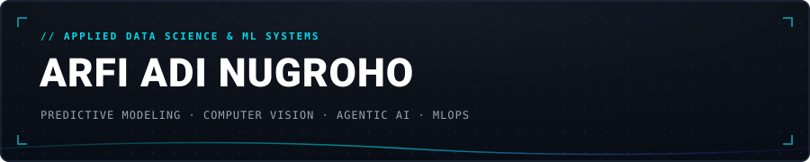

  

  

  <strong>Surabaya, Indonesia</strong> &nbsp;·&nbsp;
  <a href="https://www.linkedin.com/in/arfi-adi-nugroho-58b0a7263">LinkedIn</a> &nbsp;·&nbsp;
  <a href="mailto:arfiadi13@gmail.com">Email</a> &nbsp;·&nbsp;
  <a href="https://github.com/Arfiadi">GitHub</a> &nbsp;·&nbsp;
  <a href="https://drive.google.com/file/d/1j6cT8VzE61Nv8ten-L2FZQWsse7tI1Rs/view?usp=sharing">Verified Credentials</a>

 

  <blockquote>
    <strong>Applied Data Science Practitioner</strong> focused on architecting production-grade <strong>predictive systems</strong>, robust <strong>computer vision pipelines</strong>, and multimodal <strong>agentic AI workflows</strong>. Driven by empirical validation protocols, end-to-end data hygiene, and reproducible <strong>MLOps practices</strong>.
  </blockquote>

---

## Featured Architectures & Systems

### [HargaWatch Surabaya — Food Price Intelligence & Early Warning System](https://github.com/Arfiadi/hargawatch-surabaya)
*`Python` · `CatBoost` · `XGBoost Quantile` · `Scikit-learn` · `Next.js 15` · `Supabase PostgreSQL`*

* **Domain & Context:** Collaborative team project on spatial food price monitoring and commodity risk intelligence across Surabaya's food distribution network.
* **Role & Engineering:** Led the predictive modeling and forecasting engine: engineered zero-lookahead features integrating wholesale price transmission signals from Pasar Induk Keputran across 37 commodities; built a two-tier forecasting engine using CatBoost and XGBoost quantile regression (p10, p50, p90) for multi-horizon price distribution estimates.
* **Validation & Impact:** Developed an adaptive 4-pillar Early Warning System (EWS) coupled with automated Telegram anomaly alert logic, integrated into the team's Next.js 15 GIS disparity dashboard.
* **Deliverables:** [Repository](https://github.com/Arfiadi/hargawatch-surabaya) · [Live Demo](https://hargawatch-surabaya.vercel.app/)

---

### [Waste Image Classification — Satria Data BDC 2026](https://github.com/Arfiadi/SatDat-BDC2026-PondasiPagi)
*`PyTorch Lightning` · `ConvNeXt` · `EVA02` · `Albumentations` · `Hydra` · `Weights & Biases` · `FiftyOne` · `Cleanlab` · `FAISS`*

* **Domain & Problem:** Competitive computer vision pipeline engineered for the Satria Data 2026 Big Data Challenge (Team Pondasi Pagi), resolving extreme class imbalance and duplicate imagery.
* **Architecture & Engineering:** Curated the training dataset from 26,527 down to 26,180 verified samples via FAISS embedding deduplication, visual dataset debugging with FiftyOne, and Cleanlab label-noise auditing; structured 17 CNN and Vision Transformer experiments under Stratified 5-Fold Cross-Validation using Hydra configuration management.
* **Validation & Impact:** Engineered a soft-voting ensemble of ConvNeXt variants and EVA02, securing an **Out-Of-Fold Macro F1 of 0.9889** and a **Public Leaderboard score of 0.9793**.
* **Deliverables:** [Repository](https://github.com/Arfiadi/SatDat-BDC2026-PondasiPagi)

---

### [FlowAgent — Agentic Financial Assistant for Indonesian SMEs](https://github.com/Arfiadi/flowagent-antigravity)
*`FastAPI` · `Google Gemini 2.5 (Vertex AI)` · `Firebase Firestore` · `React` · `TypeScript` · `Cloud Run`*

* **Domain & Problem:** Multimodal generative AI and financial risk assistant automating bookkeeping and liquidity risk detection for small-to-medium enterprises.
* **Architecture & Engineering:** Multimodal ingestion pipeline powered by Gemini 2.5 Flash converting receipts, invoices, voice memos, and text into validated accounting records with human-in-the-loop verification; implemented Firestore state management to compute liquidity health scores, cash runway, and risk tiers.
* **Validation & Impact:** Engineered an agentic workflow using Gemini 2.5 Pro generating context-aware mitigation action drafts for accounts receivable and supplier negotiations; deployed as a containerized FastAPI microservice on Google Cloud Run with frontend on Firebase Hosting.
* **Deliverables:** [Repository](https://github.com/Arfiadi/flowagent-antigravity) · [Live Application](https://gen-lang-client-0964227719.web.app/)

---

### [HRSS Industrial Operational Recommendation System](https://github.com/Arfiadi/HRSS-recommendation-system)
*`Python` · `Scikit-learn` · `Random Forest` · `MLflow` · `FastAPI` · `React` · `Docker`*

* **Domain & Problem:** Industrial IoT decision-support system preventing heavy equipment failures triggered by abnormal power loads and voltage sags.
* **Architecture & Engineering:** Processed 46,898 telemetry records, eliminated target-leakage features, and evaluated a Random Forest classifier on a chronological holdout of 9,380 records; developed a hybrid recommendation engine combining ML operational pattern recognition with deterministic, rule-based safety overrides.
* **Validation & Impact:** Packaged into an end-to-end FastAPI inference microservice with automated test suites, MLflow experiment tracking, and an operational React dashboard.
* **Deliverables:** [Repository](https://github.com/Arfiadi/HRSS-recommendation-system) · [Live Demo](https://hrss-recommendation-system.vercel.app/) · [API Documentation](https://hrss-recommendation-system.onrender.com/docs)

---

## Extended Case Studies & Domain Systems

  
<strong>01 // Macro Socio-Economics & Regional Analytics (PovertyRadar & FnB Expenditure)</strong>

   

  > **[PovertyRadar SDGs — Regional Poverty Vulnerability & Clustering Platform](https://github.com/Arfiadi/poverty-radar)**  
  > *Tech: Python, Scikit-learn, Pandas, React, TypeScript, ECharts, Tailwind CSS*  
  > - Audited 514 Indonesian regencies and cities across 34 provinces using BPS data, removing leakage-prone labels and isolating 26 multivariate anomalies via Isolation Forest without discarding remote (3T) regions.  
  > - Benchmarked 20+ clustering configurations to justify K-Means ($k=4$, ARI stability of 0.9803 across 20 random seeds) across 7 structural features, mapping 4 socio-economic archetypes into a 5-act interactive storytelling dashboard.  
  > 🔗 [Repository](https://github.com/Arfiadi/poverty-radar) &nbsp;|&nbsp; [Live App](https://poverty-radar.vercel.app/)
  >
  > ---
  >
  > **[East Java Food & Beverage Consumption Clustering](https://github.com/Arfiadi/jatim-fnb-clustering)**  
  > *Tech: Python, Pandas, Scikit-learn, Streamlit, Plotly*  
  > - Applied Agglomerative Hierarchical Clustering to BPS 2024 expenditure data across 38 regencies/cities in East Java, comparing four linkage methods and selecting Ward's linkage with three clusters.  
  > - Built an interactive Streamlit dashboard with spatial mapping and PCA visualization to communicate cluster-level FMCG distribution, packaging, and pricing strategies.  
  > 🔗 [Repository](https://github.com/Arfiadi/jatim-fnb-clustering) &nbsp;|&nbsp; [Live Dashboard](https://jatim-fnb-clustering.streamlit.app/)

  
<strong>02 // Predictive Intelligence & Customer Retention (Telco Churn & Clinical Screening)</strong>

   

  > **[Telco Customer Churn Prediction & Intelligent Retention Platform](https://github.com/Arfiadi/telco-churn-classification)**  
  > *Tech: Python, Pandas, Scikit-learn, LightGBM, Optuna, SHAP, PydanticAI, Streamlit*  
  > - Engineered a leakage-safe LightGBM classification pipeline on 7,043 IBM Telco records with 4 behavioral interaction features and Optuna hyperparameter optimization; achieved **0.835 ROC-AUC** on a 20% holdout set.  
  > - Built a Streamlit retention platform featuring out-of-fold profit-threshold optimization, SHAP feature attributions, batch customer prioritization, what-if simulators, and a PydanticAI retention copilot with deterministic fallback.  
  > 🔗 [Repository](https://github.com/Arfiadi/telco-churn-classification)
  >
  > ---
  >
  > **[Heart Disease Clinical Screening & Prediction System](https://github.com/Arfiadi/heart-disease-prediction)**  
  > *Tech: Python, Scikit-learn, MLflow, SHAP, Streamlit, Gemini API*  
  > - Evaluated Logistic Regression, Decision Tree, MLP, and Random Forest on clinical screening data using stratified cross-validation; selected Random Forest (**82.8% test accuracy, 0.898 ROC-AUC**) with SHAP explanations.  
  > - Built a Streamlit clinical decision-support app featuring interactive risk gauges, AI lifestyle recommendations with rule-based fallbacks, and downloadable screening reports.  
  > 🔗 [Repository](https://github.com/Arfiadi/heart-disease-prediction) &nbsp;|&nbsp; [Live App](https://heart-disease-predictiongit-yuguekaou65jhemfr9kj2g.streamlit.app/)

  
<strong>03 // Enterprise Data Warehousing, BI & Market Intelligence (Global Inventory & JobStreet)</strong>

   

  > **[Global Inventory Business Intelligence Pipeline](https://github.com/Arfiadi/global-inventory-bi-pipeline)**  
  > *Tech: MySQL, PostgreSQL, Pentaho PDI, Python, Prophet, XGBoost, Power BI*  
  > - Built an end-to-end decision-support pipeline: automated Pentaho ETL workflow transforming transactional MySQL records into a PostgreSQL star-schema warehouse and SQL semantic layer.  
  > - Applied Spectral Clustering for inventory SKU segmentation and benchmarked Prophet against XGBoost and SARIMAX, where Prophet achieved the lowest MAPE; delivered via an interactive Power BI executive report.  
  > 🔗 [Repository](https://github.com/Arfiadi/global-inventory-bi-pipeline) &nbsp;|&nbsp; [Power BI Dashboard](https://app.powerbi.com/view?r=eyJrIjoiYzFkYzE2ZjItMjZmZi00MmFmLTk3ODktMDJjNmY4MDFhNzNiIiwidCI6IjUxZDc5MGQ1LWJlZmItNDg0ZS04NmM2LWQxN2I2NDcyNzYyNCIsImMiOjEwfQ%3D%3D)
  >
  > ---
  >
  > **[JobStreet Data Analysis — Indonesia Data Job Market](https://github.com/Arfiadi/jobstreet-data-analysis)**  
  > *Tech: Python, Pandas, Matplotlib, Seaborn, WebScraper.io*  
  > - Cleaned and analyzed 878 data job listings on JobStreet Indonesia (collected 1 June 2025), standardizing job titles, salary tiers, hiring types, and regional requirements.  
  > - Identified market demand concentrations in Greater Jakarta and quantified skills premiums across Data Analyst, Data Scientist, and Data Engineer roles.  
  > 🔗 [Repository](https://github.com/Arfiadi/jobstreet-data-analysis)

  
<strong>04 // Full-Stack AI Services & Competition Benchmarks (AI Interview, ARA 7.0, Gelar Rasa)</strong>

   

  > **[AI Interview Coach](https://github.com/Arfiadi/app-interview)**  
  > *Tech: Next.js, TypeScript, FastAPI, OpenRouter, PostgreSQL, Redis, Docker*  
  > - Full-stack interview simulation platform generating role- and experience-specific interview questions with AI scoring against STAR-method criteria and personalized improvement feedback.  
  > - Implemented JWT authentication, session persistence, candidate performance analytics, and automated PDF report export on a multi-container Docker architecture.  
  > 🔗 [Repository](https://github.com/Arfiadi/app-interview) &nbsp;|&nbsp; [Live App](https://app-interview-xi.vercel.app/) &nbsp;|&nbsp; [API Docs](https://interview-backend-737275753890.asia-southeast1.run.app/docs)
  >
  > ---
  >
  > **[Pothole Semantic Segmentation — ARA 7.0 ITS Competition 2026](https://github.com/Arfiadi/ARA-ITS-2026)**  
  > *Tech: PyTorch, segmentation_models_pytorch, Albumentations, OpenCV*  
  > - Built a road damage segmentation pipeline using U-Net++ with an EfficientNet-B4 encoder and a hybrid Dice/BCE loss, evaluated through 5-fold cross-validation.  
  > - Integrated test-time augmentation (TTA) and morphological filtering to refine mask boundaries across variable road lighting and textures.  
  > 🔗 [Repository](https://github.com/Arfiadi/ARA-ITS-2026)
  >
  > ---
  >
  > **[FMCG Product Revenue Forecasting — Gelar Rasa DSC 2025](https://github.com/Arfiadi/GelarRasa-DSC2025)**  
  > *Tech: Python, LightGBM, Prophet, Statsmodels, Scikit-learn*  
  > - Developed hierarchical revenue forecasts using Prophet at the aggregate level (**MAPE < 2%**) and ARIMAX at the product level (**MAPE 2–5%**), aligned via MinT reconciliation.  
  > - Assessed product cannibalization using Interrupted Time Series (ITS) and Synthetic Control Methods.  
  > 🔗 [Repository](https://github.com/Arfiadi/GelarRasa-DSC2025)
  >
  > ---
  >
  > **[Aquaculture Water Quality Classification](https://github.com/SoviaLearner/satria-water-quality-ews)**  
  > *Tech: Scikit-learn, LightGBM, MLflow, FastAPI, Docker, Google Cloud Run*  
  > - Evaluated four classifiers across 4,300 records for four-class water suitability; deployed inference microservice on Cloud Run with MLflow model management.  
  > 🔗 [Repository](https://github.com/SoviaLearner/satria-water-quality-ews) &nbsp;|&nbsp; [Live App](https://satria-water-quality-ews-sage.vercel.app/)
  >
  > ---
  >
  > **[Gastrointestinal Infection Expert System](https://github.com/Arfiadi/expertsystem-gastrousus)**  
  > *Tech: Python, Streamlit*  
  > - Rule-based expert system evaluating 19 reported clinical symptoms to rank five infection and food-poisoning hypotheses with transparent diagnostic scores.  
  > 🔗 [Repository](https://github.com/Arfiadi/expertsystem-gastrousus) &nbsp;|&nbsp; [Live App](https://arfiadi-expertsystem-gastrousus-diagnosis-gastrousus-pykpyh.streamlit.app/)

---

## Technical Competencies

* **Core Programming & Query Languages:** Python, SQL, R, TypeScript
* **Machine Learning & Deep Learning:** PyTorch, PyTorch Lightning, Scikit-learn, LightGBM, CatBoost, XGBoost, Prophet, Statsmodels, Albumentations, OpenCV
* **Generative AI & Agentic Systems:** Google Gemini API (Vertex AI), Multimodal Extraction, Agentic Workflows, PydanticAI, OpenRouter
* **Data Engineering & Storage:** PostgreSQL, MySQL, Supabase, Pentaho Data Integration (ETL), Star Schema Dimensional Modeling, Redis, Apache Spark, Hadoop
* **MLOps & Production Infrastructure:** Docker, FastAPI, MLflow, Weights & Biases, Google Cloud Run, Git, Streamlit, Linux, Automated Testing, CI/CD
* **Analytics & Visualization:** Power BI, ECharts, Plotly, Pandas, NumPy, Seaborn, Matplotlib

---

## Academic Credentials & Certifications

* **Politeknik Elektronika Negeri Surabaya (PENS)**  
  *Diploma IV (Applied Bachelor) in Applied Data Science* (2024–Present) &nbsp;·&nbsp; **Current GPA: 3.70 / 4.00**  
  *Relevant Coursework:* Applied Statistical Modeling, Applied Statistical Analysis, Machine Learning, Data Mining, MLOps, Data Warehousing, Big Data Infrastructure & Management, Artificial Intelligence, Web Service Technology.

* **Professional Certifications & Bootcamps:**
  * DQLab Machine Learning & AI Bootcamp (Batch 14)
  * Google Cloud Gen AI Academy APAC (Cohort 1)
  * [Verified Credential Portfolio (Google Drive)](https://drive.google.com/file/d/1j6cT8VzE61Nv8ten-L2FZQWsse7tI1Rs/view?usp=sharing)

